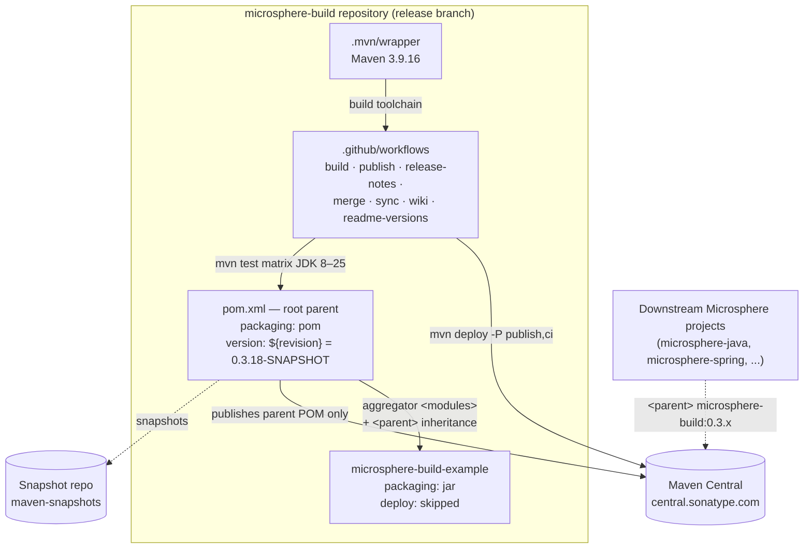
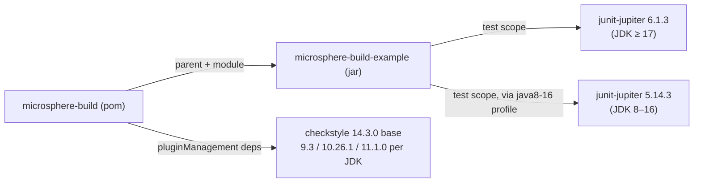
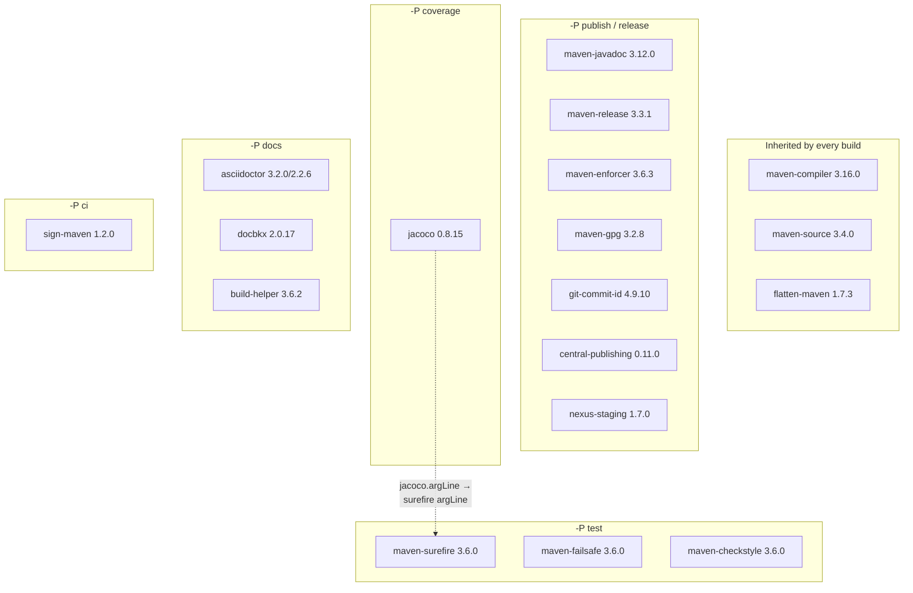

# Developer Guide — `release` branch (current)

[English](README.md) | [简体中文](zh/README.md)

This guide is for **maintainers of the `microsphere-build` repository**. It explains the architecture of the parent
POM, analyses `pom.xml` source, documents the design patterns in use, and gives Mermaid flow/sequence diagrams for
the complex build and CI/CD flows.

> Analysed from branch `release` at `0.3.18-SNAPSHOT`. The `release-1.x` branch does not exist, so only the
> `current/` documentation set is provided.

## Documents (one per Maven module + cross-cutting)

| Document | Scope |
|---|---|
| [microsphere-build.md](microsphere-build.md) | Root parent POM — source analysis of `pom.xml`: section layout, effective build lifecycle, profile interaction model, flatten/CI-friendly machinery |
| [microsphere-build-example.md](microsphere-build-example.md) | Example module — how it validates the parent contract; source analysis of `ExampleService` and its tests |
| [build-pipeline.md](build-pipeline.md) | CI/CD — flow diagrams of the seven GitHub Actions workflows and the release publishing sequence |

## Architecture at a glance

Key architectural facts:

1. **The product is a POM, not a JAR.** The only artifact consumers obtain is the parent POM itself (plus its
   flattened form). `microsphere-build-example` is deliberately excluded from deployment.
2. **Single source of build truth.** All plugin versions live as `*.version` properties in the root `<properties>`
   block and are referenced only from `<pluginManagement>` — children override by property, never by copy-paste
   plugin XML.
3. **Behaviour is layered by profiles.** Six manual profiles (`publish`, `release`, `ci`, `test`, `coverage`, `docs`)
   attach heavy plugins on demand; six JDK-range profiles (`java8+`, `java9+`, `java11+`, `java9-15`, `java16+`,
   `java17+`) auto-adjust tool versions and JVM flags. See
   [microsphere-build.md § Profile interaction model](microsphere-build.md#profile-interaction-model).
4. **Version is a build parameter.** `${revision}` + Flatten plugin + `-Drevision=` in the publish workflow make the
   POM versionless at rest and versioned in flight.

## Module dependency relationships

Within the reactor:

External build-tool dependencies of the parent (all in `pluginManagement`; activated per profile as shown in the
[User Guide](../../user-guide/current/microsphere-build.md)):

