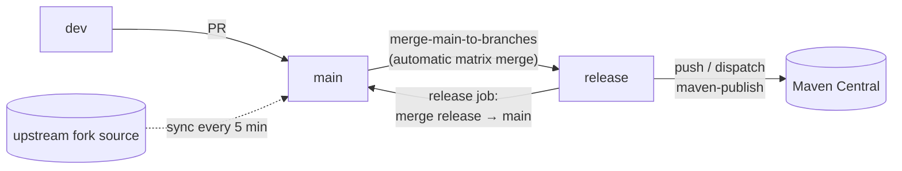
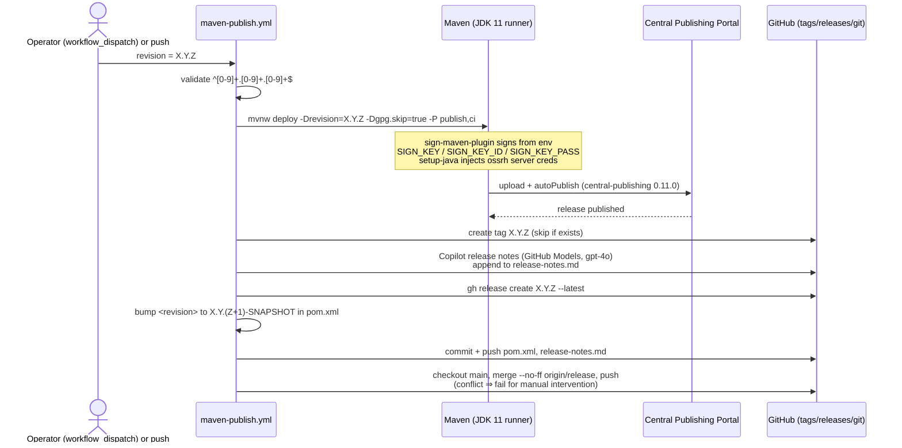

# Build Pipeline & CI/CD — Developer Guide

[English](build-pipeline.md) | [简体中文](zh/build-pipeline.md)

Sources analysed: `.github/workflows/` on branch `release` (seven workflows).

| Workflow | Trigger | Purpose |
|---|---|---|
| `maven-build.yml` | push `main`/`dev`; PR to `main`/`dev`/`release` | JDK 8/11/17/21/25 matrix build (`test,docs,coverage`) + Codecov upload |
| `maven-publish.yml` | push `release`; `workflow_dispatch(revision)` | Publish to Maven Central, tag, GitHub release, version bump, merge back to `main` |
| `generate-release-notes.yml` | push `release`; `workflow_dispatch(revision)` | Copilot-generated release notes + tag + GitHub release (release-notes variant) |
| `merge-main-to-branches.yml` | push `main` | Matrix-merges `main` → `dev`, `main` → `release` |
| `sync-branches-from-upstream.yml` | cron `*/5` (watches `main`/`dev`/`dev-1.x`) | Pulls fork branches from upstream |
| `publish-wiki.yml` | push `main`; manual | Publishes the `wiki/` directory to the GitHub Wiki repo |
| `update-readme-versions.yml` | push `main`/`dev`; manual | Syncs plugin versions from `pom.xml` into `README.md` |

## Branch model



- `main` is the integration branch; `release` is the **publishing branch** — pushing to it *performs a release*.
- The publish workflow merges `release` back into `main` at the end, keeping the bumped `revision` and
  `release-notes.md` in sync.

## Maven Build workflow

```mermaid
flowchart TD
    T["push main|dev or PR → main|dev|release"] --> M["matrix: java = 8, 11, 17, 21, 25"]
    M --> C1[checkout@v7.0.1] --> C2["setup-java@v6.0.1<br/>temurin + maven cache"]
    C2 --> B["mvn --batch-mode --debug --update-snapshots<br/>-Drevision=0.0.1-SNAPSHOT<br/>test -P test,docs,coverage"]
    B --> J8["JDK 8: java8+ profile<br/>checkstyle 9.3, asciidoctor 2.2.6"]
    B --> J11["JDK 11/17/21/25:<br/>java9+, java11+, (java16+, java17+)<br/>--add-opens argLine"]
    J8 & J11 --> CO["jacoco report →<br/>codecov-action@v7.1.1<br/>(fail_ci_if_error: false)"]
```

Note: the CI build pins `-Drevision=0.0.1-SNAPSHOT` so matrix legs never collide with real versions, and it runs
`test` (not `package`/`deploy`) — signing plugins are never exercised in CI builds.

## Maven Publish workflow (release pipeline)

Two dependent jobs, `build` then `release`:



Required repository secrets and their environment mapping:

| Secret | Env var consumed by | Used by |
|---|---|---|
| `OSS_SONATYPE_USERNAME` / `OSS_SONATYPE_PASSWORD` | `MAVEN_USERNAME` / `MAVEN_PASSWORD` (server id `ossrh`) | central-publishing plugin |
| `OSS_SIGNING_KEY_ID_LONG` | `SIGN_KEY_ID` | sign-maven-plugin (`ci`) |
| `OSS_SIGNING_KEY` | `SIGN_KEY` | sign-maven-plugin (`ci`) |
| `OSS_SIGNING_PASSWORD` | `SIGN_KEY_PASS` | sign-maven-plugin (`ci`) |
| `CODECOV_TOKEN` | codecov action | coverage upload (build workflow) |
| `GITHUB_TOKEN` | `GH_TOKEN` | release creation, Copilot models API |

## Why `-Dgpg.skip=true` with the `ci` profile

The `publish` profile activates `maven-gpg-plugin`, which needs a local keyring — unavailable in GitHub runners.
`-Dgpg.skip=true` disables it, while `sign-maven-plugin` (added by `-P ci`) performs the same `.asc` signing purely
from environment variables. Both produce Central-required signatures; the GPG plugin remains for local/manual
releases.

## Version lifecycle across the pipeline

```mermaid
stateDiagram-v2
    [*] --> "0.3.17 on release<br/>(just published)"
    "0.3.17 on release<br/>(just published)" --> "0.3.18-SNAPSHOT": bump-patch job (automated)
    "0.3.18-SNAPSHOT" --> "0.3.18-SNAPSHOT": main→release merges<br/>accumulate changes
    "0.3.18-SNAPSHOT" --> "0.3.18 published": dispatch maven-publish<br/>-Drevision=0.3.18
    "0.3.18 published" --> "0.3.19-SNAPSHOT": bump-patch job
```

The `<revision>` property at rest is always a `-SNAPSHOT`; the real version exists only inside a workflow run via
`-Drevision`. This is the same CI-friendly mechanism described in
[microsphere-build.md § 5](microsphere-build.md#5-ci-friendly-version-resolution-flatten--sequence).

## Maintenance checklist for workflows

- Action versions are pinned by dependabot (`checkout@v7.0.1`, `setup-java@v6.0.1`, `codecov-action@v7.1.1`);
  bump them together, the publish pipeline assumes `setup-java`'s `server-id: ossrh` credential injection.
- The version regex in `Validate version format` is the only guard against a bad dispatch input — extend it
  deliberately if the project ever moves to 4-segment versions.
- `release`-into-`main` merge conflicts abort the run **after** Central publishing succeeded; recover by merging
  manually, never by re-dispatching the same revision (artifacts are already live).

---

Previous: [microsphere-build-example.md](microsphere-build-example.md) · Index: [README.md](README.md)
