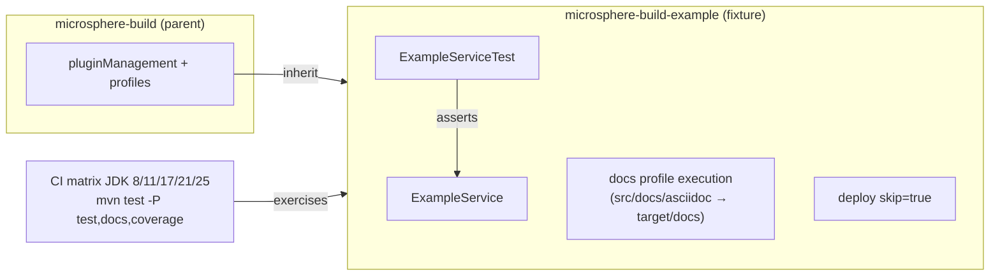
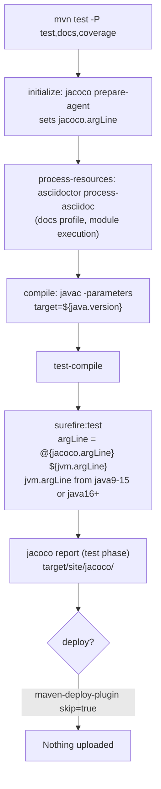

# Microsphere Build Example — Developer Guide

[English](microsphere-build-example.md) | [简体中文](zh/microsphere-build-example.md)

Sources analysed (branch `release`):

- `microsphere-build-example/pom.xml` (80 lines)
- `microsphere-build-example/src/main/java/io/github/microsphere/example/ExampleService.java`
- `microsphere-build-example/src/test/java/io/github/microsphere/example/ExampleServiceTest.java`

## 1. Architectural role

The module is a **build harness**, not a product. Every parent-POM feature must be exercised by at least one thing
that actually compiles, tests, instruments and signs during CI; this module supplies that "something". It is a
single-purpose fixture kept in the reactor so `mvn test -P test,docs,coverage` on JDK 8–25 validates the parent
end-to-end. Deployment is disabled so the fixture can never leak to Central.



## 2. Source analysis — `ExampleService`

```java
public String greet(String name) {
    if (name == null || name.isEmpty()) {
        throw new IllegalArgumentException("name must not be null or empty");
    }
    return "Hello, " + name + "!";
}

public String getJavaVersion() {
    return System.getProperty("java.specification.version");
}
```

Design notes:

- **Two methods with complementary coverage needs.** `greet` is pure and deterministic (branch coverage: null /
  empty / normal). `getJavaVersion` touches the JVM environment, so its test is a *runtime probe*: it fails if the
  Surefire JVM on a given JDK cannot even start property access correctly, which is exactly what the JDK-activated
  `--add-opens` / `--illegal-access` flags protect.
- **Defensive parameter check throwing `IllegalArgumentException`** — deliberately no external dependency, keeping
  the module's compile classpath empty (JUnit is `test` scope only). An empty compile classpath is itself a test of
  the parent's compiler configuration.
- The class javadoc enumerates the profiles under validation; it doubles as living documentation of the coverage
  matrix. If a new profile is added to the parent, this list is one of the places to update.

## 3. Source analysis — `ExampleServiceTest`

Five JUnit 5 tests map one-to-one onto build features:

| Test | Feature validated |
|---|---|
| `testGreet`, `testGreetWithCustomName` | Surefire include pattern `**/*Test.java`; `-parameters` compilation; assertion wiring |
| `testGreetWithNullName`, `testGreetWithEmptyName` | Exception-assertion path; deep reflection into JDK internals works under `java16+` `--add-opens` |
| `testGetJavaVersion` | Environment access on every JDK in the CI matrix (8 → 25) |

The test class is named `*Test` (not `*Tests`) and is not `Abstract*` — matching the Surefire include/exclude
conventions inherited from the parent, thereby testing those conventions implicitly.

## 4. POM analysis (module-local overrides)

| Element | Analysis |
|---|---|
| `<parent>` with `${revision}` + `<relativePath>../pom.xml</relativePath>` | Reactor-internal parent resolution; only valid because the module is never published. |
| `junit.version` default `6.1.3` | JUnit 6 requires Java 17+, hence: |
| Profile `java8-16`, activation `[1.8,17)` → `junit.version=5.14.3` | An **example-local** JDK-range override — demonstrates the parent's pattern of environment-driven configuration without touching the parent. |
| `maven-deploy-plugin` `<skip>true</skip>` | Bound in root `<build><plugins>` of the module; overrides the parent-managed deploy behaviour. |
| Profile `docs` re-declares an `asciidoctor-maven-plugin` execution with explicit `sourceDirectory`/`outputDirectory` | Shows the intended child-side activation recipe for the parent's `docs` profile (the parent only manages version/plugin defaults; the child binds the execution). |

## 5. Build flow for this module



Note the checkstyle nuance: in `test` profile the checkstyle execution is active with `skip=${disable.checks}` and
the parent default is `true`, so style checks run only when a consumer sets `-Ddisable.checks=false` (CI runs
`test,docs,coverage`; see [build-pipeline.md](build-pipeline.md)).

## 6. Maintenance guidelines

- Keep this module **dependency-minimal** (test-scope JUnit only). Adding compile dependencies would weaken its
  role as a clean-room test of the parent's compiler/resource configuration.
- When the parent gains a profile or plugin, add a corresponding exercise here (source, test, or docs resource) so
  CI covers it; update the class-javadoc profile list.
- JUnit major upgrades must maintain the `java8-16` downgrade profile, otherwise JDK 8–16 CI legs break.

---

Previous: [microsphere-build.md](microsphere-build.md) · Next: [build-pipeline.md](build-pipeline.md)
