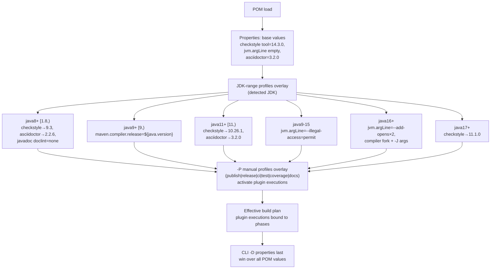
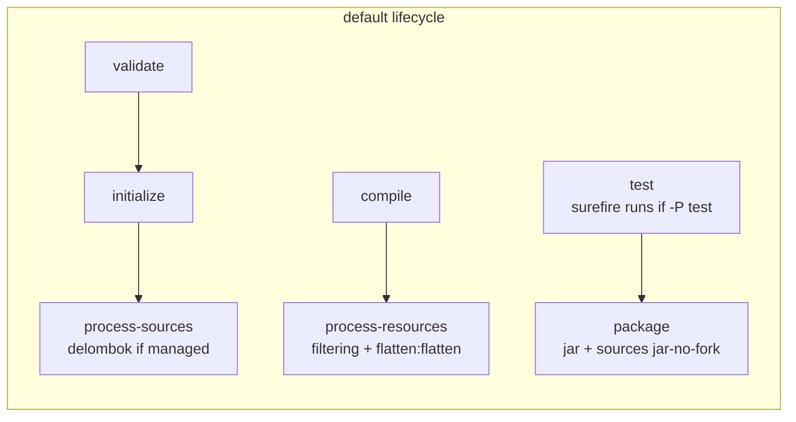
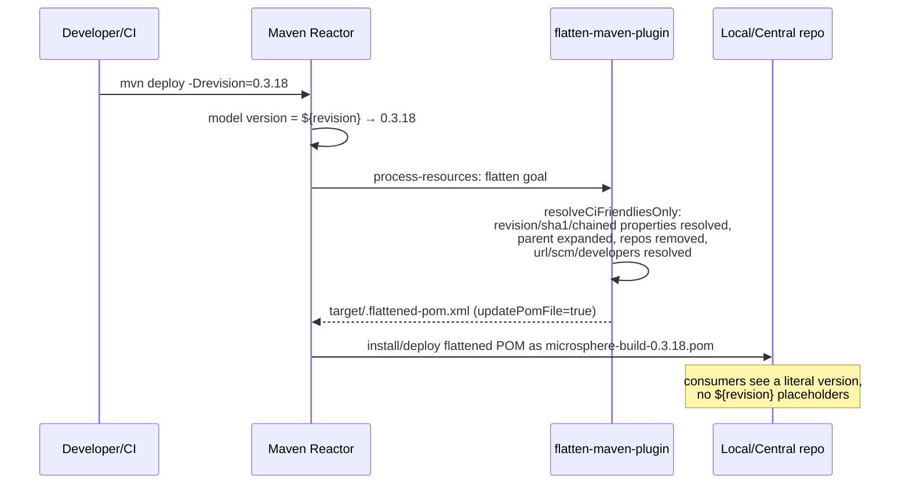

# Microsphere Build (Parent POM) — Developer Guide

[English](microsphere-build.md) | [简体中文](zh/microsphere-build.md)

Source analysed: `pom.xml` on branch `release` (835 lines, `0.3.18-SNAPSHOT`). There is no Java source in the root
module — **the POM *is* the source code**, so "source analysis" here means a structural walkthrough of `pom.xml`.

## 1. File layout of the root POM

| `pom.xml` section | Lines (approx.) | Responsibility |
|---|---|---|
| Coordinates + `${revision}` | 9–14 | Self-referential CI-friendly version: `<version>${revision}</version>`, `packaging: pom` |
| `<modules>` | 17–19 | Reactor aggregation — currently only `microsphere-build-example` |
| `<licenses>` / `<developers>` / `<scm>` | 23–46 | Metadata that the flatten plugin resolves into child POMs (`url`/`scm`/`developers` = `resolve`) |
| `<properties>` | 48–124 | Three clusters: core build settings, ~25 `*.version` plugin pins, flatten/checkstyle/argLine knobs |
| `<build><pluginManagement>` | 127–511 | Configured defaults for 21 plugins — versions + executions, **no activation** |
| `<build><plugins>` | 513–526 | The three always-inherited plugins: compiler, source, flatten |
| `<build><resources>` | 528–544 | Filtering of `src/main/java` (`*.properties`, `*.xml`) and all of `src/main/resources` |
| `<profiles>` | 547–800 | 6 manual + 6 JDK-auto profiles |
| `<reporting>` | 802–809 | Site reporting: checkstyle |
| `<repositories>` / `<distributionManagement>` | 811–834 | Snapshot consumption & publication endpoints on `central.sonatype.com` |

Note the deliberate split: everything heavy sits in `pluginManagement` so children get *configuration if they
activate it*, while only three plugins appear in the root `<plugins>` and are therefore inherited unconditionally.

## 2. Design patterns

| Pattern | Where | Why it matters here |
|---|---|---|
| **Parent / Template Method** | root `<parent>` contract | The parent fixes the build skeleton (phases, plugin bindings); children "fill in" only via properties. Overriding a behaviour = overriding a property, never duplicating plugin XML. |
| **Bill of Materials (version catalog)** | `*.version` properties | Single pin per plugin; dependabot bumps one line. Children override by re-declaring the property. |
| **Progressive/Profile-based activation** | 12 `<profiles>` | Heavy cross-cutting concerns (signing, coverage, style checks) are opt-in, keeping the default build fast. |
| **Environment-driven configuration** | JDK-range profile activation, `@{...}` late-binding, `SIGN_KEY*` env vars | The same POM adapts to JDK 8–25 and to CI vs local keyrings without editing. |
| **Convention over configuration** | resource filtering, `*Test*` includes, `ossrh` server id, `src/docs/asciidoc` | Microsphere projects share one set of conventions; the parent encodes them once. |
| **CI-friendly versioning (versionless-at-rest)** | `${revision}` + flatten `resolveCiFriendliesOnly` + `updatePomFile=true` | No commit ever needs a version bump just to build; the publish workflow injects `-Drevision=x.y.z`. |

## 3. Profile interaction model

Manual profiles and JDK profiles write to the **same property slots**, and Maven's profile resolution order is
declaration order in `<profiles>`. This is the subtlest part of the POM and the most likely source of maintenance
bugs.

Consequences that maintainers must respect:

- On JDK 17, `checkstyle` resolves through `java8+` → `java11+` → `java17+` in declaration order, ending at
  **11.1.0**; the base 14.3.0 property is *never* effective on any JDK unless a profile is somehow inactive.
- `jvm.argLine` is written by both `java9-15` and `java16+`; their ranges are disjoint so exactly one wins.
- Surefire consumes the result **late-bound** via `@{jacoco.argLine}` (a `argLine` expression evaluated by
  Surefire at fork time). JaCoCo's `prepare-agent` writes that property during `initialize`; without the
  `late-binding substitution`, plain `${...}` would be interpolated too early and drop the agent.

## 4. Effective lifecycle — default build (`mvn clean package`)

`flatten:flatten` is bound to `process-resources` with `updatePomFile=true`, so the POM that ends up inside the
packaged artifact and the repository is the flattened one (`.flattened-pom.xml` in `target/`).

## 5. CI-friendly version resolution (flatten) — sequence

## 6. Snapshot consumption design

`<repositories>` declares the Central `maven-snapshots` repo with `<releases><enabled>false</enabled></releases>`.
Rationale: downstream Microsphere projects can depend on `0.3.18-SNAPSHOT` right after the publish workflow bumps
`revision` on `release`, while release resolution is never polluted by repository-level lookups (Central itself is
Maven's default super-POM repo).

## 7. Extension points (how to evolve the parent)

| Change | Correct place | Pitfall to avoid |
|---|---|---|
| Add a managed plugin | `pluginManagement` + a `*.version` property; optionally bind via a new profile | Do not put it into root `<plugins>` — that forces it on every child build |
| Support a new JDK | New/extended JDK-range profile | Keep ranges disjoint where profiles write the same property |
| Bump a plugin | `*.version` property (dependabot PRs do this) | Checkstyle tool bumps must stay JDK-profile compatible (9.3 is the last Java 8 line) |
| Change publishing target | `central-publishing-maven-plugin` config + `distributionManagement` | `publish` and `release` profiles must not both be active: two staging plugins would race |
| Add a child module | root `<modules>` + child `<parent>` with `${revision}`+`<relativePath>` | Set `maven-deploy-plugin skip` for non-published modules |

## 8. Compatibility contract for consumers

- **Patch/minor bumps are safe**: only `*.version` properties move; property names and profile ids are stable API.
- **Breaking changes** would be: removing a profile id, renaming a property, changing default `java.version`.
  None have occurred across 0.1.x → 0.3.x.
- Version history relevant to maintainers: `publish` + central-publishing added in 0.2.0 (OSSRH EOL);
  example module deployment skipped from the commit after 0.3.17; wrapper moved 3.9.16 (release) / 3.10.0 (main).

---

Next: [microsphere-build-example.md](microsphere-build-example.md) ·
[Build pipeline & CI/CD](build-pipeline.md)
