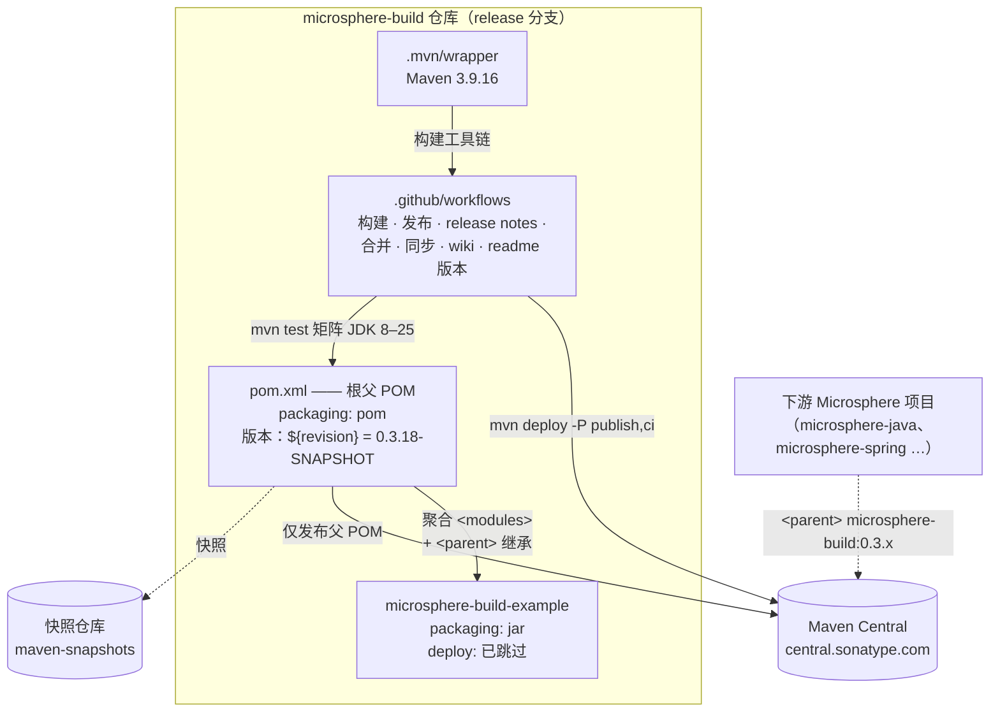
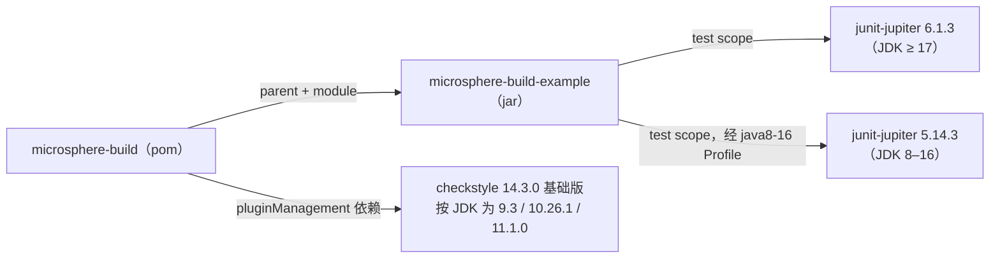
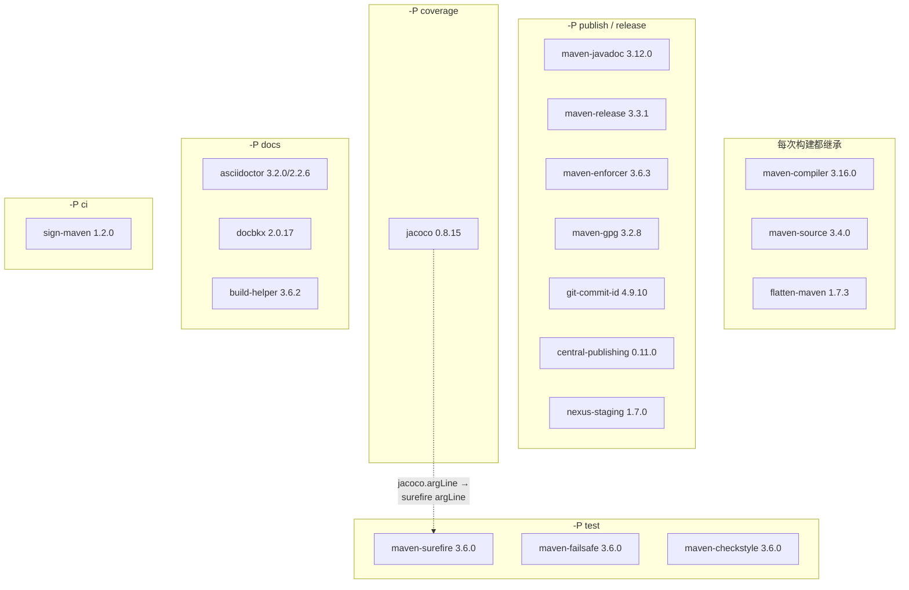

# 开发者文档 —— `release` 分支（current）

[English](../README.md) | [简体中文](README.md)

本文档面向 **`microsphere-build` 仓库的维护者**。它解释父 POM 的架构设计、分析 `pom.xml` 源码、梳理其中使用的
设计模式，并用 Mermaid 流程图/时序图描述复杂的构建与 CI/CD 流程。

> 依据 `release` 分支 `0.3.18-SNAPSHOT` 分析。仓库不存在 `release-1.x` 分支，因此只提供 `current/` 文档集。

## 文档（每个 Maven 模块一篇 + 跨模块主题）

| 文档 | 范围 |
|---|---|
| [microsphere-build.md](microsphere-build.md) | 根父 POM —— `pom.xml` 源码分析：章节布局、生效构建生命周期、Profile 交互模型、flatten/CI 友好版本机制 |
| [microsphere-build-example.md](microsphere-build-example.md) | 示例模块 —— 它如何验证父 POM 契约；`ExampleService` 及其测试的源码分析 |
| [build-pipeline.md](build-pipeline.md) | CI/CD —— 七个 GitHub Actions 工作流的流程图与发布时序图 |

## 架构总览

关键架构事实：

1. **产品是 POM，不是 JAR。** 使用者获得的唯一制品就是父 POM 本身（及其扁平化形式）。
   `microsphere-build-example` 被刻意排除在部署之外。
2. **构建事实的单一来源。** 所有插件版本都以 `*.version` 属性形式存在于根 `<properties>` 中，且只被
   `<pluginManagement>` 引用 —— 子项目通过属性覆盖，绝不复制粘贴插件 XML。
3. **行为按 Profile 分层。** 六个手动 Profile（`publish`、`release`、`ci`、`test`、`coverage`、`docs`）按需挂载
   重型插件；六个 JDK 区间 Profile（`java8+`、`java9+`、`java11+`、`java9-15`、`java16+`、`java17+`）自动调整
   工具版本与 JVM 参数。参见
   [microsphere-build.md § Profile 交互模型](microsphere-build.md#3-profile-交互模型)。
4. **版本是一个构建参数。** `${revision}` + Flatten 插件 + 发布工作流中的 `-Drevision=`，使 POM 在静止状态下
   无版本、在飞行中有版本。

## 模块依赖关系

reactor 内部：

父 POM 对外部构建工具的依赖（全部位于 `pluginManagement`；按下图所示按 Profile 激活，详见
[用户文档](../../../user-guide/current/zh/microsphere-build.md)）：

