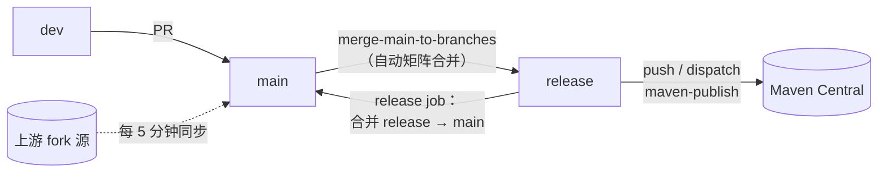
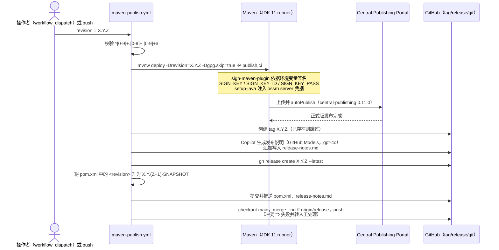

# 构建流水线与 CI/CD —— 开发者文档

[English](../build-pipeline.md) | [简体中文](../build-pipeline.md)

分析源码：`release` 分支上的 `.github/workflows/`（共七个工作流）。

| 工作流 | 触发条件 | 用途 |
|---|---|---|
| `maven-build.yml` | push `main`/`dev`；针对 `main`/`dev`/`release` 的 PR | JDK 8/11/17/21/25 矩阵构建（`test,docs,coverage`）+ Codecov 上传 |
| `maven-publish.yml` | push `release`；`workflow_dispatch(revision)` | 发布到 Maven Central、打 tag、创建 GitHub Release、升版本、回合 `main` |
| `generate-release-notes.yml` | push `release`；`workflow_dispatch(revision)` | Copilot 生成 release notes + tag + GitHub Release（发布说明变体） |
| `merge-main-to-branches.yml` | push `main` | 以矩阵方式把 `main` 合入 `dev`、`release` |
| `sync-branches-from-upstream.yml` | cron `*/5`（关注 `main`/`dev`/`dev-1.x`） | 从上游同步 fork 分支 |
| `publish-wiki.yml` | push `main`；手动 | 把 `wiki/` 目录发布到 GitHub Wiki 仓库 |
| `update-readme-versions.yml` | push `main`/`dev`；手动 | 将 `pom.xml` 中的插件版本同步进 `README.md` |

## 分支模型



- `main` 是集成分支；`release` 是**发布分支** —— 向它 push 即*执行一次发布*。
- 发布工作流在最后把 `release` 合回 `main`，从而保持升好的 `revision` 与 `release-notes.md` 同步。

## Maven Build 工作流

```mermaid
flowchart TD
    T["push main|dev 或 PR → main|dev|release"] --> M["矩阵：java = 8, 11, 17, 21, 25"]
    M --> C1[checkout@v7.0.1] --> C2["setup-java@v6.0.1<br/>temurin + maven 缓存"]
    C2 --> B["mvn --batch-mode --debug --update-snapshots<br/>-Drevision=0.0.1-SNAPSHOT<br/>test -P test,docs,coverage"]
    B --> J8["JDK 8：java8+ Profile<br/>checkstyle 9.3，asciidoctor 2.2.6"]
    B --> J11["JDK 11/17/21/25：<br/>java9+、java11+、（java16+、java17+）<br/>--add-opens argLine"]
    J8 & J11 --> CO["jacoco 报告 →<br/>codecov-action@v7.1.1<br/>（fail_ci_if_error: false）"]
```

注意：CI 构建固定使用 `-Drevision=0.0.1-SNAPSHOT`，使矩阵各分支之间不会与真实版本冲突；并且只执行 `test`
（而非 `package`/`deploy`）—— CI 构建中不会触发签名类插件。

## Maven Publish 工作流（发布流水线）

`build` 与 `release` 两个存在依赖关系的 job：



所需的仓库 secrets 及其环境变量映射：

| Secret | 被谁通过哪个环境变量消费 | 使用者 |
|---|---|---|
| `OSS_SONATYPE_USERNAME` / `OSS_SONATYPE_PASSWORD` | `MAVEN_USERNAME` / `MAVEN_PASSWORD`（server id 为 `ossrh`） | central-publishing 插件 |
| `OSS_SIGNING_KEY_ID_LONG` | `SIGN_KEY_ID` | sign-maven-plugin（`ci`） |
| `OSS_SIGNING_KEY` | `SIGN_KEY` | sign-maven-plugin（`ci`） |
| `OSS_SIGNING_PASSWORD` | `SIGN_KEY_PASS` | sign-maven-plugin（`ci`） |
| `CODECOV_TOKEN` | codecov action | 覆盖率上传（构建工作流） |
| `GITHUB_TOKEN` | `GH_TOKEN` | 创建 Release、Copilot models API |

## 为什么 `ci` Profile 要配合 `-Dgpg.skip=true`

`publish` Profile 会激活 `maven-gpg-plugin`，而它需要本地密钥环 —— GitHub runner 上并不具备。
`-Dgpg.skip=true` 关闭它，同时由 `sign-maven-plugin`（由 `-P ci` 引入）完全基于环境变量完成相同签名。
两者产出的都是 Central 要求的签名；保留 GPG 插件是为了本地/手动发布场景。

## 版本在流水线中的生命周期

```mermaid
stateDiagram-v2
    [*] --> "release 上的 0.3.17<br/>（刚发布）"
    "release 上的 0.3.17<br/>（刚发布）" --> "0.3.18-SNAPSHOT": bump-patch job（自动）
    "0.3.18-SNAPSHOT" --> "0.3.18-SNAPSHOT": main→release 合并<br/>持续累积变更
    "0.3.18-SNAPSHOT" --> "0.3.18 已发布": dispatch maven-publish<br/>-Drevision=0.3.18
    "0.3.18 已发布" --> "0.3.19-SNAPSHOT": bump-patch job
```

静止状态下的 `<revision>` 永远是一个 `-SNAPSHOT`；真实版本只在某次工作流运行中通过 `-Drevision` 存在。
这与 [microsphere-build.md 第 5 节](microsphere-build.md#5-ci-友好版本解析flatten-时序) 所描述的 CI 友好机制
是同一套。

## 工作流维护清单

- Action 版本由 dependabot 固定升级（`checkout@v7.0.1`、`setup-java@v6.0.1`、`codecov-action@v7.1.1`）；
  请成组升级，发布流水线依赖 `setup-java` 的 `server-id: ossrh` 凭据注入机制。
- `Validate version format` 中的正则是防止误触发 dispatch 的唯一护栏 —— 若项目将来改为四段版本号，需要有意识地
  扩展它。
- 把 `release` 合入 `main` 若发生冲突，会在 Central 发布成功**之后**中止运行；正确的恢复方式是手工合并，
  绝不要对同一个 revision 重新 dispatch（制品已经上线）。

---

上一篇：[microsphere-build-example.md](microsphere-build-example.md) · 索引：[README.md](README.md)
