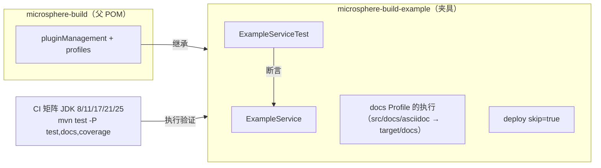
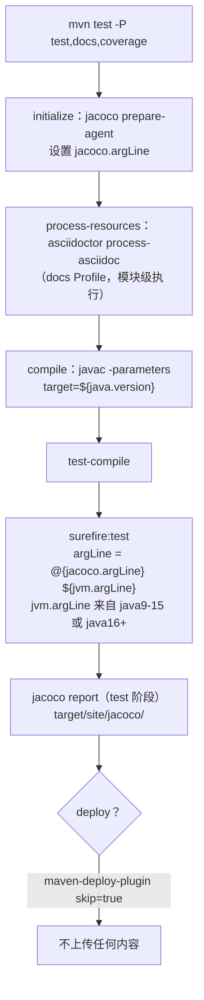

# Microsphere Build Example —— 开发者文档

[English](../microsphere-build-example.md) | [简体中文](microsphere-build-example.md)

分析源码（`release` 分支）：

- `microsphere-build-example/pom.xml`（80 行）
- `microsphere-build-example/src/main/java/io/github/microsphere/example/ExampleService.java`
- `microsphere-build-example/src/test/java/io/github/microsphere/example/ExampleServiceTest.java`

## 1. 架构定位

本模块是一个**构建工装（build harness）**，而不是产品。父 POM 的每一项能力都必须至少被某样东西真正执行——
编译、测试、插桩、签名——CI 才有意义；这个模块提供的就是那个“某样东西”。它是单一用途的夹具，留在 reactor 中，
使得在 JDK 8–25 上执行 `mvn test -P test,docs,coverage` 能够端到端验证父 POM。部署被关闭，因此该夹具绝不可能
泄漏到 Central。



## 2. 源码分析 —— `ExampleService`

```java
public String greet(String name) {
    if (name == null || name.isEmpty()) {
        throw new IllegalArgumentException("name must not be null or empty");
    }
    return "Hello, " + name + "!";
}

public String getJavaVersion() {
    return System.getProperty("java.specification.version");
}
```

设计要点：

- **两个方法对应互补的覆盖需求。** `greet` 纯粹且确定（分支覆盖：null / 空串 / 正常）。`getJavaVersion` 触碰 JVM
  运行环境，因此它的测试是一个*运行时探针*：如果某个 JDK 上的 Surefire JVM 连读取系统属性都不正常，测试就会失败 ——
  而这正是 JDK 自动激活的 `--add-opens` / `--illegal-access` 参数所要保护的场景。
- **防御式参数校验并抛出 `IllegalArgumentException`** —— 刻意不引入任何外部依赖，使模块的编译 classpath 保持为空
  （JUnit 仅在 `test` 作用域）。空编译 classpath 本身就是对父 POM 编译器配置的一次测试。
- 类级 javadoc 枚举了正在被验证的 Profile 清单，兼作覆盖矩阵的活文档。当父 POM 新增 Profile 时，这里是需要同步
  更新的位置之一。

## 3. 源码分析 —— `ExampleServiceTest`

五个 JUnit 5 测试与构建能力一一对应：

| 测试 | 验证的构建能力 |
|---|---|
| `testGreet`、`testGreetWithCustomName` | Surefire include 规则 `**/*Test.java`；`-parameters` 编译；断言接线 |
| `testGreetWithNullName`、`testGreetWithEmptyName` | 异常断言路径；在 `java16+` 的 `--add-opens` 下对 JDK 内部类的深度反射可用 |
| `testGetJavaVersion` | CI 矩阵中每个 JDK（8 → 25）上的环境访问能力 |

测试类命名为 `*Test`（而非 `*Tests`）且不以 `Abstract*` 开头 —— 恰好匹配从父 POM 继承的 Surefire include/exclude
约定，从而隐式地测试了这些约定。

## 4. POM 分析（模块本地覆盖项）

| 元素 | 分析 |
|---|---|
| `<parent>` 使用 `${revision}` + `<relativePath>../pom.xml</relativePath>` | reactor 内部的 parent 解析；正因为本模块永不发布，这样写才成立。 |
| `junit.version` 默认 `6.1.3` | JUnit 6 需要 Java 17+，于是需要： |
| Profile `java8-16`，激活条件 `[1.8,17)` → `junit.version=5.14.3` | 一个**模块本地**的 JDK 区间覆盖 —— 在不改动父 POM 的前提下演示父 POM 的“环境驱动配置”模式。 |
| `maven-deploy-plugin` `<skip>true</skip>` | 声明在模块自身的 `<build><plugins>` 中，覆盖父 POM 受管的 deploy 行为。 |
| 模块 `docs` Profile 重新声明了一个 `asciidoctor-maven-plugin` 执行，显式指定 `sourceDirectory`/`outputDirectory` | 展示子项目侧激活父 POM `docs` Profile 的预期写法（父 POM 只受管版本与插件默认值，由子项目绑定执行）。 |

## 5. 本模块的构建流程



关于 checkstyle 的一个细节：`test` Profile 中 checkstyle 执行处于激活状态，但其 `skip=${disable.checks}`，而父 POM
的默认值是 `true`，因此只有当使用者显式设置 `-Ddisable.checks=false` 时才会真正执行风格检查（CI 运行的是
`test,docs,coverage`；见 [build-pipeline.md](build-pipeline.md)）。

## 6. 维护准则

- 保持本模块**依赖极简**（仅 test 作用域的 JUnit）。增加编译期依赖会削弱它作为父 POM 编译器/资源配置净室测试
  的角色。
- 当父 POM 新增 Profile 或插件时，在本模块补充对应的执行载体（源码、测试或文档资源），使 CI 覆盖它；同时更新
  类级 javadoc 中的 Profile 清单。
- JUnit 大版本升级必须保留 `java8-16` 降级 Profile，否则 JDK 8–16 的 CI 分支会失败。

---

上一篇：[microsphere-build.md](microsphere-build.md) · 下一篇：[build-pipeline.md](build-pipeline.md)
