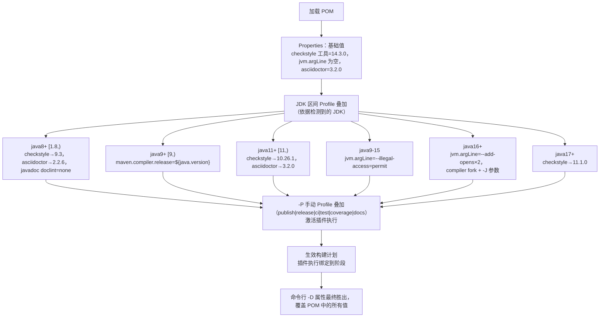
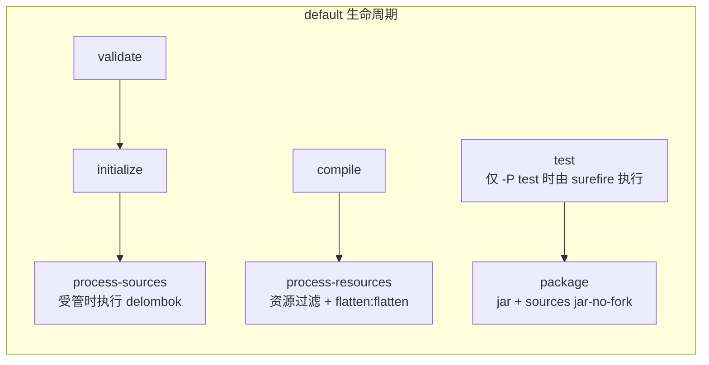
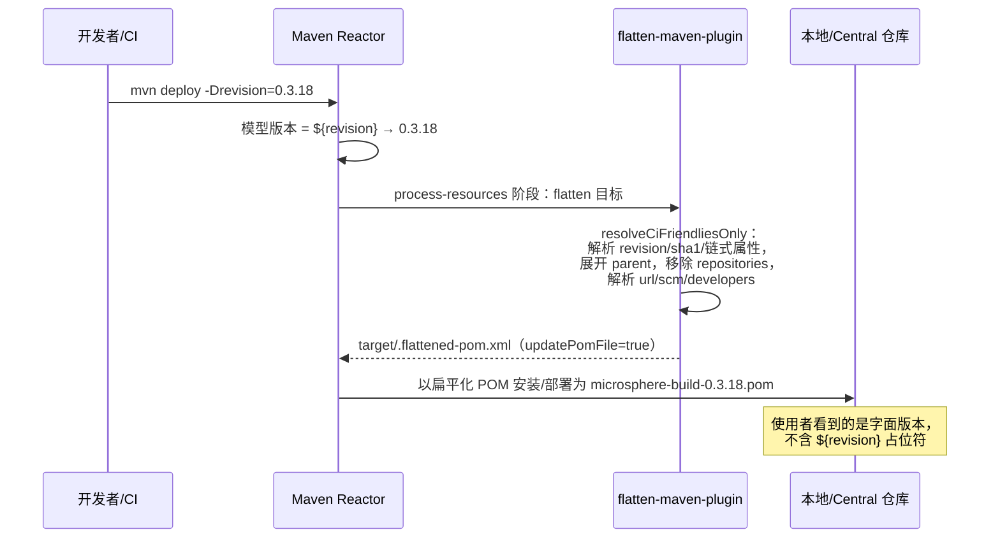

# Microsphere Build（父 POM）—— 开发者文档

[English](../microsphere-build.md) | [简体中文](microsphere-build.md)

分析源码：`release` 分支上的 `pom.xml`（共 835 行，`0.3.18-SNAPSHOT`）。根模块没有 Java 源码 ——
**POM 本身就是源码**，因此这里的“源码分析”指对 `pom.xml` 的结构性逐段解读。

## 1. 根 POM 的文件布局

| `pom.xml` 章节 | 行号（近似） | 职责 |
|---|---|---|
| 坐标 + `${revision}` | 9–14 | 自引用的 CI 友好版本：`<version>${revision}</version>`，`packaging: pom` |
| `<modules>` | 17–19 | reactor 聚合 —— 当前只有 `microsphere-build-example` |
| `<licenses>` / `<developers>` / `<scm>` | 23–46 | 由 flatten 插件解析进子 POM 的元数据（`url`/`scm`/`developers` = `resolve`) |
| `<properties>` | 48–124 | 三簇内容：核心构建设置、约 25 个 `*.version` 插件固定值、flatten/checkstyle/argLine 开关 |
| `<build><pluginManagement>` | 127–511 | 21 个插件的配置默认值 —— 版本 + 执行，**不含激活** |
| `<build><plugins>` | 513–526 | 三个无条件继承的插件：compiler、source、flatten |
| `<build><resources>` | 528–544 | 过滤 `src/main/java`（`*.properties`、`*.xml`）与整个 `src/main/resources` |
| `<profiles>` | 547–800 | 6 个手动 Profile + 6 个 JDK 自动 Profile |
| `<reporting>` | 802–809 | 站点报告：checkstyle |
| `<repositories>` / `<distributionManagement>` | 811–834 | `central.sonatype.com` 上的快照消费与发布端点 |

注意其中刻意的分层：所有重型内容都放在 `pluginManagement`，使子项目获得的是“**若激活则生效**”的配置；
只有三个插件出现在根 `<plugins>` 中，因而被无条件继承。

## 2. 设计模式

| 模式 | 位置 | 在本项目中的意义 |
|---|---|---|
| **父工程 / 模板方法（Template Method）** | 根 `<parent>` 契约 | 父 POM 固化了构建骨架（阶段、插件绑定）；子项目只通过属性“填空”。覆盖某个行为 = 覆盖某个属性，绝不重复插件 XML。 |
| **物料清单（版本目录）** | `*.version` 属性 | 每个插件只固定一处；dependabot 只改一行。子项目通过重新声明属性来覆盖。 |
| **渐进式 / 基于 Profile 的激活** | 12 个 `<profiles>` | 重型横切关注点（签名、覆盖率、风格检查）按需启用，保持默认构建轻量。 |
| **环境驱动配置** | JDK 区间 Profile 激活、`@{...}` 延迟绑定、`SIGN_KEY*` 环境变量 | 同一份 POM 自适应 JDK 8–25 以及 CI 与本地密钥环的差异，无需修改。 |
| **约定优于配置** | 资源过滤、`*Test*` includes、`ossrh` server id、`src/docs/asciidoc` | 整个 Microsphere 生态共享一套约定，父 POM 一次性编码它们。 |
| **CI 友好版本化（静止无版本）** | `${revision}` + flatten `resolveCiFriendliesOnly` + `updatePomFile=true` | 任何提交都不必为了构建而升版本；发布工作流通过 `-Drevision=x.y.z` 注入真实版本。 |

## 3. Profile 交互模型

手动 Profile 与 JDK Profile 写入的是**同一批属性槽位**，而 Maven 的 Profile 解析顺序就是 `<profiles>` 中的声明
顺序。这是本 POM 中最精微、也最可能埋下维护隐患的部分。

维护者必须理解的三个推论：

- 在 JDK 17 上，`checkstyle` 依声明顺序经历 `java8+` → `java11+` → `java17+`，最终落在 **11.1.0**；基础属性中的
  14.3.0 在任何 JDK 上都**不会**生效（除非某个 Profile 以某种方式未被激活）。
- `jvm.argLine` 同时被 `java9-15` 与 `java16+` 写入；两者区间互斥，因此恰好只有一个生效。
- Surefire 通过 `@{jacoco.argLine}` **延迟绑定**消费其结果（由 Surefire 在 fork 时求值的 `argLine` 表达式）。
  JaCoCo 的 `prepare-agent` 在 `initialize` 阶段写入该属性；若改用普通 `${...}` 插值，会在过早的时点被解析，
  从而丢失 agent。

## 4. 生效生命周期 —— 默认构建（`mvn clean package`）

`flatten:flatten` 绑定在 `process-resources`，且 `updatePomFile=true`，因此最终进入打包制品与仓库的 POM 是
扁平化后的那份（位于 `target/` 的 `.flattened-pom.xml`）。

## 5. CI 友好版本解析（flatten）—— 时序

## 6. 快照消费的设计

`<repositories>` 声明了 Central 的 `maven-snapshots` 仓库，并设置 `<releases><enabled>false</enabled></releases>`。
理由：当下游 Microsphere 项目需要在发布工作流把 `revision` 升为下一个快照后立刻依赖 `0.3.18-SNAPSHOT` 时可以直接
消费；同时仓库级查找永远不会污染正式版解析（Central 本身已是 Maven super-POM 的默认仓库）。

## 7. 扩展点（如何演进父 POM）

| 变更 | 正确落点 | 需要避免的坑 |
|---|---|---|
| 新增受管插件 | `pluginManagement` + 一个 `*.version` 属性；必要时通过新 Profile 绑定执行 | 不要放进根 `<plugins>` —— 那会强制加给每一个子构建 |
| 支持新 JDK | 新增/扩展 JDK 区间 Profile | 写入同一属性的 Profile，其区间必须保持互斥 |
| 升级插件 | `*.version` 属性（dependabot PR 就是这样做的） | checkstyle 工具升级必须与 JDK Profile 兼容（9.3 是最后的 Java 8 分支） |
| 更换发布目标 | `central-publishing-maven-plugin` 配置 + `distributionManagement` | `publish` 与 `release` 不得同时激活：两个 staging 插件会互相竞争 |
| 新增子模块 | 根 `<modules>` + 子 POM 的 `<parent>`（`${revision}` + `<relativePath>`） | 不发布的模块要设置 `maven-deploy-plugin skip` |

## 8. 对使用者的兼容性契约

- **补丁/次版本升级是安全的**：只移动 `*.version` 属性；属性名与 Profile id 属于稳定 API。
- **破坏性变更**是指：移除某个 Profile id、重命名某个属性、更改默认 `java.version`。
  从 0.1.x 到 0.3.x 从未发生过此类变更。
- 与维护者相关的版本脉络：0.2.0 引入 `publish` + central-publishing（应对 OSSRH 停服）；
  自 0.3.17 之后的提交起跳过示例模块部署；Wrapper 版本为 3.9.16（release 分支）/ 3.10.0（main 分支）。

---

下一篇：[microsphere-build-example.md](microsphere-build-example.md) ·
[构建流水线与 CI/CD](build-pipeline.md)
