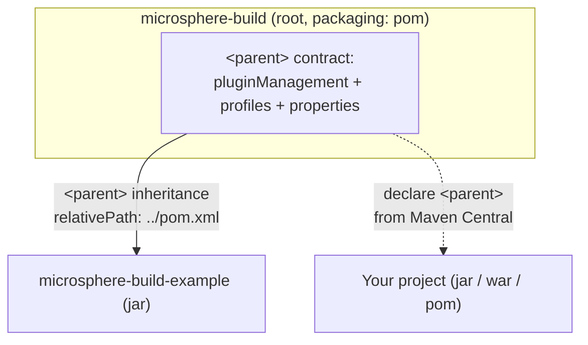

# User Guide — `release` branch (current)

[English](README.md) | [简体中文](zh/README.md)

This guide covers **Microsphere Build `0.3.18-SNAPSHOT`** (analysed from the `release` branch; the latest
published release is `0.3.17`). It is written for consumers of the parent POM — Java/Maven projects that declare
`microsphere-build` as their `<parent>`.

> Documentation is produced **only** from the `release` branch. The `release-1.x` branch does not exist in this
> repository, therefore no `1.x/` documentation set is provided.

## Modules

| Module | Packaging | Published? | Document |
|---|---|---|---|
| `microsphere-build` (root) | `pom` | Yes (Maven Central) | [microsphere-build.md](microsphere-build.md) |
| `microsphere-build-example` | `jar` | No — `maven-deploy-plugin` `skip=true`; it is an in-repo validation module | [microsphere-build-example.md](microsphere-build-example.md) |

## Module dependency relationship

## Where to start

1. Read [Getting Started](microsphere-build.md#get-getting-started-with-the-parent-pom) in the parent POM reference:
   set the parent, pick `java.version`, build.
2. Consult [microsphere-build.md](microsphere-build.md) for the full property/profile reference and version
   compatibility.
3. Look at [microsphere-build-example.md](microsphere-build-example.md) for a worked example — its code examples are
   taken from the module's own test cases.

## Version & compatibility summary

| Item | Value |
|---|---|
| Parent version analysed | `0.3.18-SNAPSHOT` (`release` branch) |
| Latest published release | `0.3.17` |
| JDKs supported (build runtime) | 8, 11, 17, 21, 25 (CI-tested matrix, Temurin) |
| Default bytecode target | Java 8 (`java.version=8`, overridable) |
| Maven version | 3.9.16 via Maven Wrapper on `release`; Maven 3.9+ recommended |
| Minimum Maven | 3.5+ required for CI-friendly `${revision}` support |
