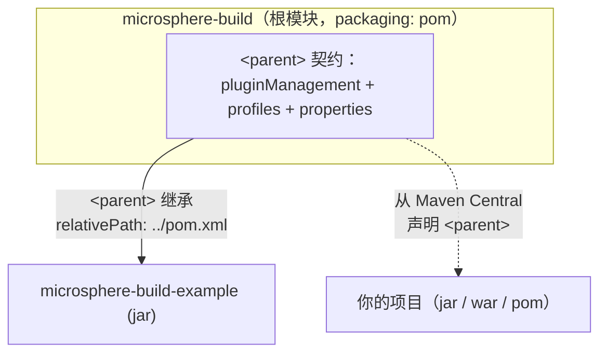

# 用户文档 —— `release` 分支（current）

[English](../README.md) | [简体中文](README.md)

本指南面向 **Microsphere Build `0.3.18-SNAPSHOT`**（依据 `release` 分支分析得出；最新已发布版本为
`0.3.17`）。读者对象是该父 POM（parent POM）的使用方 —— 也就是把 `microsphere-build` 声明为自己 `<parent>` 的
Java/Maven 项目。

> 文档**仅**基于 `release` 分支产出。本仓库中不存在 `release-1.x` 分支，因此不提供 `1.x/` 文档集合。

## 模块

| 模块 | 打包方式 | 是否发布？ | 文档 |
|---|---|---|---|
| `microsphere-build`（根模块） | `pom` | 是（Maven Central） | [microsphere-build.md](microsphere-build.md) |
| `microsphere-build-example` | `jar` | 否 —— `maven-deploy-plugin` 配置了 `skip=true`；它是仓库内的构建验证模块 | [microsphere-build-example.md](microsphere-build-example.md) |

## 模块依赖关系

## 从哪里开始

1. 先阅读父 POM 参考文档中的[快速上手](microsphere-build.md#get-getting-started-with-the-parent-pom)：设置 parent、
   选定 `java.version`、执行构建。
2. 需要完整的属性/Profile 参考以及版本兼容性时，查阅 [microsphere-build.md](microsphere-build.md)。
3. 想看一个完整的示例，请参考 [microsphere-build-example.md](microsphere-build-example.md) —— 其中的代码示例都取自
   该模块自身的测试用例。

## 版本与兼容性摘要

| 条目 | 值 |
|---|---|
| 所分析的父 POM 版本 | `0.3.18-SNAPSHOT`（`release` 分支） |
| 最新已发布版本 | `0.3.17` |
| 支持的 JDK（构建运行时） | 8、11、17、21、25（CI 测试矩阵，Temurin） |
| 默认字节码目标 | Java 8（`java.version=8`，可覆盖） |
| Maven 版本 | `release` 分支上通过 Maven Wrapper 使用 3.9.16；建议使用 Maven 3.9+ |
| 最低 Maven 版本 | 需要 3.5+ 才支持 CI 友好的 `${revision}` |
